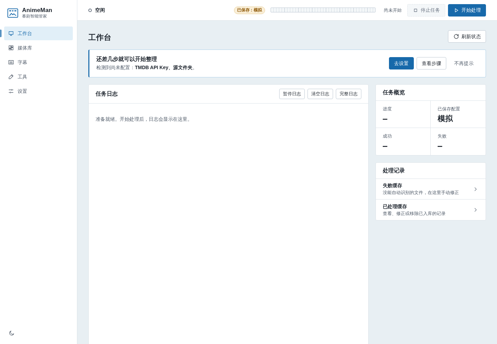
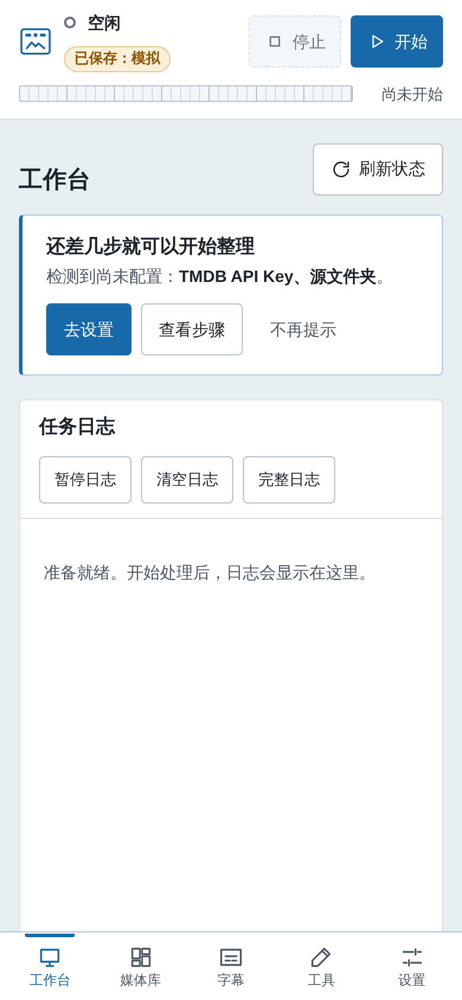
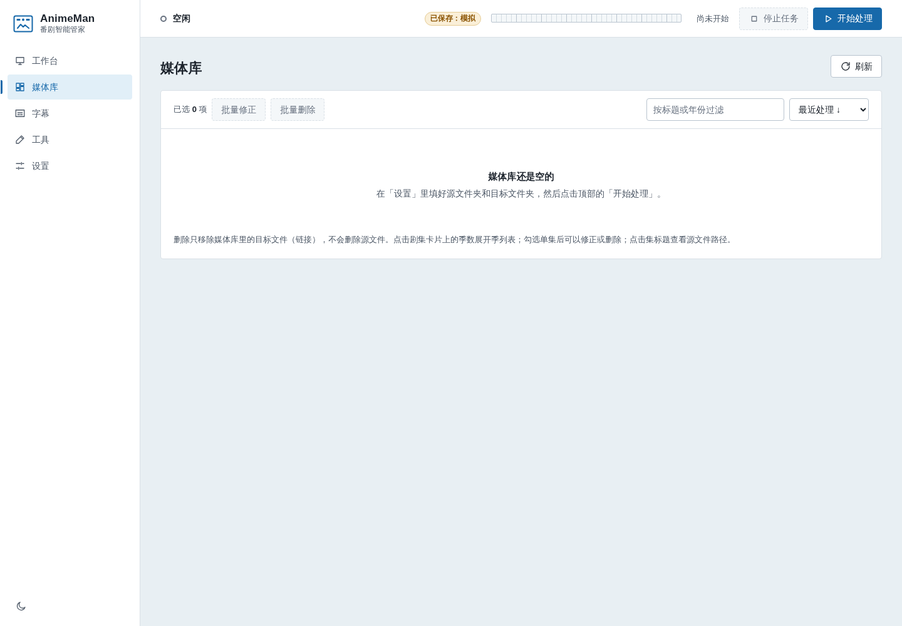
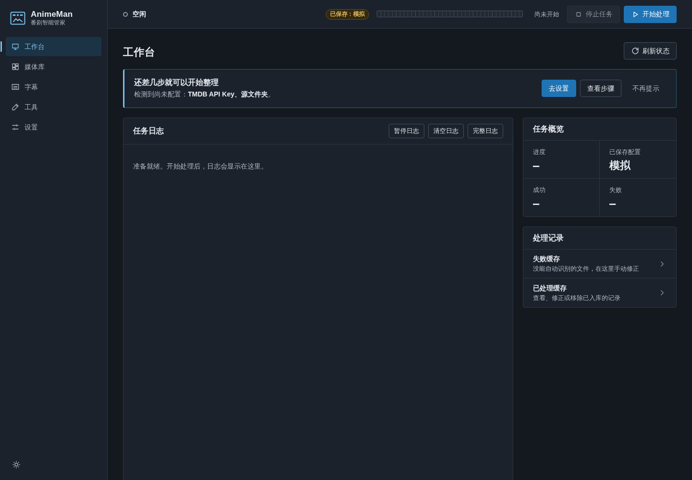
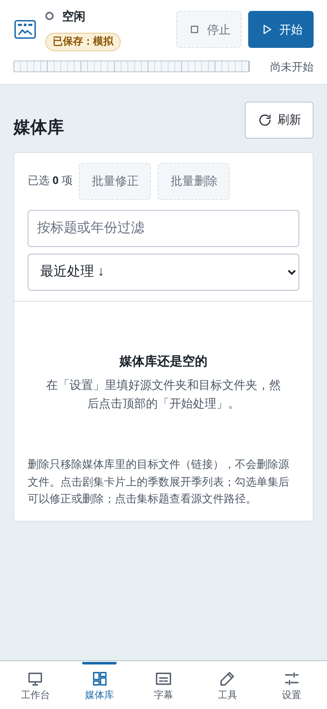

<div align="center">

# AnimeMan

**番剧与影视媒体管理工具**

文件名解析 · TMDB 元数据 · 链接入库 · 字幕整理 · Web 管理

[](https://github.com/gegd19/AnimeMan/releases/latest)
[](https://github.com/gegd19/AnimeMan/actions/workflows/ci.yml)
[](DEPLOYMENT.md)
[](docker-compose.yml)
[](#许可证)

[功能一览](#功能一览) · [界面预览](#界面预览) · [快速开始](#快速开始) · [运行与安全](#运行与安全) · [文档与开发](#文档与开发)

</div>

---

AnimeMan 将下载目录中的视频整理为媒体库需要的目录、链接、NFO 和图片。规则与 anitopy 负责基础解析，AI 可作为辅助；遇到不确定的结果，可以在 Web 面板中搜索、选择并修正。

适合希望保留下载目录，同时管理电影、番剧、特典和字幕的用户。视频整理以创建链接为主，硬链接要求同一文件系统；跨文件系统可尝试符号链接。

## 功能一览

| 功能 | 可以做什么 |
| --- | --- |
| **解析与入库** | 解析文件名与目录，查询 TMDB，生成电影/剧集目录、NFO 和图片；支持模拟、增量及全量处理。 |
| **媒体库管理** | 电影与 TV 分开展示，支持搜索、排序、季集展开、分页，以及单项/批量修正和删除。 |
| **失败项修正** | 按文件夹查看失败记录，搜索 TMDB，调整文件顺序并预览季集分配；明确映射可用于特典与 S00。 |
| **字幕中心** | 扫描、匹配、选择目标媒体、创建字幕链接；可选 ffsubsync 调轴，临时处理与原字幕分开。 |
| **AI 辅助** | 可选文件夹预解析、字幕匹配与简介润色；返回值经过校验，未知信息保留给后续处理。 |
| **统一工作台** | 常驻任务条、日志暂停/清空、五个功能视图，以及浅色、深色、跟随系统主题。 |
| **运行保护** | 路径边界校验、同名冲突保护、原子缓存提交、旧缓存备份、单写任务互斥与密钥脱敏。 |

AI 不是必需组件。启用后可能产生接口费用，实际用量与计费以服务商为准；识别准确性受文件名、目录和元数据质量影响。

## 界面预览

以下为**本机实际运行的 v1.1.0 截图**，不是设计稿或模拟 API 页面。截图时为首次安装状态，尚未配置 TMDB Key、导入媒体或运行整理任务，因此媒体库为空。

<table>
  <tr>
    <th width="72%">桌面工作台</th>
    <th width="28%">手机工作台</th>
  </tr>
  <tr>
    <td valign="top"><a href="docs/images/local-desktop-dashboard.png"></a></td>
    <td valign="top"><a href="docs/images/local-phone-dashboard.png"></a></td>
  </tr>
</table>

<details>
<summary><strong>查看更多：媒体库、深色主题与手机媒体库</strong></summary>

### 媒体库

电影/剧集的入口、筛选与批量操作集中在同一视图；本图展示尚未导入媒体时的空状态。



### 深色主题



### 手机媒体库



</details>

截图来源与尺寸见 [图片说明](docs/images/README.md)。

## 快速开始

> 新用户先用少量样本和模拟模式检查结果。已有部署升级前，应先停止写任务、等待线程退出，并备份配置、完整缓存及旧版本；不要直接删除旧容器或运行目录。

### Docker Compose

```bash
git clone https://github.com/gegd19/AnimeMan.git
cd AnimeMan
git checkout v1.1.0

# 准备运行目录；保留已有配置
mkdir -p config cache logs work
cp -n .env.example .env
```

启动前完成以下配置：

1. 编辑 `.env`：设置媒体绝对路径 `SOURCE_DIR`、`TV_DIR`、`MOVIE_DIR`，以及实际用户的 `PUID` / `PGID`。
2. 为 `SECRET_KEY` 设置私有随机值，可运行 `python -c "import secrets; print(secrets.token_hex(32))"` 生成。
3. 让指定 UID/GID 可以写入配置、缓存、日志、work 和目标目录；源目录只需读取与遍历权限。
4. 按 [部署说明](DEPLOYMENT.md#首次准备-compose) 创建启用认证的配置。已有配置应保留并核对，不覆盖。

```bash
docker compose config --quiet
docker compose up -d --build
docker compose ps
```

默认访问 **<http://127.0.0.1:8000>**。需要远程访问时，先确认认证已开启，再配置 `BIND_IP` 和网络访问方式。

<details>
<summary>持久化目录与环境变量说明</summary>

| 宿主目录 | 容器路径 | 用途 |
| --- | --- | --- |
| `./config` | `/app/config` | 应用配置与认证信息 |
| `./cache` | `/app/cache` | 处理记录与派生缓存 |
| `./logs` | `/app/logs` | 运行日志 |
| `./work` | `/app/work` | 字幕等临时工作文件 |
| `SOURCE_DIR` | `/media/source` | 视频源目录，只读 |
| `TV_DIR` / `MOVIE_DIR` | `/media/tv` / `/media/movies` | 媒体目标目录，可写 |

Compose 默认以 UID/GID `1000:1000` 运行，不自动创建缺失的宿主 bind 路径。示例中的媒体路径环境变量优先于配置文件，相应输入在界面中只读；修改后需重启。

旧容器写在 `/app` 根目录的数据不会自动出现在新挂载卷中。迁移方法见 [T04 运行数据说明](T04-NOTES.md)，权限与 rootless Docker 差异见 [部署说明](DEPLOYMENT.md)。

</details>

### 源码运行

以下为 Linux/macOS 的虚拟环境示例，使用 **Python 3.12**；发布验证版本为 3.12.15。字幕调轴还需要可用的 FFmpeg。

```bash
git clone https://github.com/gegd19/AnimeMan.git
cd AnimeMan
git checkout v1.1.0

python3.12 -m venv .venv
. .venv/bin/activate
python -m pip install --require-hashes -r requirements.lock
python -m pip check

# 首次安装复制示例；已有文件不覆盖
cp -n auto_config.json.example auto_config.json
# 编辑实际源/目标路径和 TMDB Key；启用认证时设置自己的用户名与密码
python web_app.py
```

启动后访问 **<http://127.0.0.1:8000>**，在“设置”中完成配置。密钥不会回显，留空保留已保存值；清除通过对应选项显式操作。

入口使用单进程 Waitress。运行路径、参数、认证初始化与停机方法见 [DEPLOYMENT.md](DEPLOYMENT.md)。

### 第一次整理

1. **设置路径**：填入源目录、剧集目标和电影目标，确认源/目标边界正确。
2. **配置元数据**：填入 TMDB Key；按需启用 AI，并保存配置。
3. **先运行模拟**：检查识别、季集号和目标冲突；有歧义的项目在失败记录中修正。
4. **再执行实际整理**：确认配置后关闭模拟并保存，然后启动新任务。

“已保存：模拟”表示当前保存的配置；**正在运行的任务继续使用启动时的配置**，中途保存不会改变该任务的运行方式。

## 运行与安全

### 任务与停机

- 同一服务一次接受一个写任务，覆盖整理、纠错、删除、字幕及离线扫描/解析。冲突时返回 HTTP 409。
- 点击停止后保持“正在停止”，直到工作线程退出；重复点击不会强制清空活任务状态。
- 停机宽限到期会报告超时并继续等待写线程。Compose 使用 `stop_grace_period: -1s`，避免引擎随后强杀；其他启动方式也需保持相同策略。
- 请由**单个写进程**管理同一媒体库，不配置多个 worker 或重叠副本。外部 SIGKILL、断电和存储故障不属于正常停机保证。

### 预览、冲突与缓存

- 模拟模式不写媒体、元数据或处理缓存，但仍会输出日志，也可能调用 AI/TMDB。配置保存、显式缓存管理和离线缓存操作是独立操作。
- 同名不同目标文件会拒绝覆盖；纠错失败保留已有成功记录与产物。
- 缓存损坏会保留原件、生成备份并报错；旧格式迁移先备份，不以清空缓存代替修复。
- 人工确认与算法评分分开展示；无评分不伪装成 100%。未知季集不默认成第一集。
- 字幕调轴使用独立临时目录；批量改名按独立校验规则执行，需要确认源/目标和冲突。

### 命令行示例

```bash
# 模拟整理
python main.py --config /absolute/path/auto_config.json --dry-run

# 全量重新评估，仍保留人工禁止重试项
python main.py --config /absolute/path/auto_config.json --force-full

# 先预览已有库的元数据修复计划
python main.py --config /absolute/path/auto_config.json --repair --dry-run
```

完整边界与恢复步骤见下方维护记录，升级时按相关说明处理缓存备份和格式兼容。

## 文档与开发

| 文档 | 内容 |
| --- | --- |
| [部署说明](DEPLOYMENT.md) | 安装、路径、权限、生产入口、停机、升级与回滚 |
| [发布说明](RELEASE_NOTES.md) | v1.1.0 界面更新与版本兼容要求 |
| [测试说明](TESTING.md) | 隔离数据、mock API、Python/浏览器/容器验证 |
| [界面改版说明](UI-REFRESH-NOTES.md) | 设计、交互变化、复核修复和未测项 |
| [版本与附件](https://github.com/gegd19/AnimeMan/releases) | 源码、补丁、截图与校验文件 |

**v1.1.0 发布验证**：Python **691 项**、前端 **55 项**通过，Linux / Docker / Windows 路径 CI 通过。Windows 路径探针不等于全部平台与真实设备验收；具体边界见发布说明。

```bash
python -m pip install --require-hashes -r requirements-dev.lock
npm ci --ignore-scripts
npx playwright install chromium

python tools/check_dependencies.py
python tools/check_syntax.py
PYTHONDONTWRITEBYTECODE=1 python -m pytest -q --tb=short
ANIMEMAN_TEST_PYTHON=python npm run test:ui
```

测试使用临时合成文件与 mock AI/TMDB，不使用真实密钥或用户媒体。应用前端为 Jinja2 + 原生 JavaScript/CSS，无需单独的前端构建流程。

<details>
<summary><strong>维护记录：T01–T15</strong></summary>

| 主题 | 记录 |
| --- | --- |
| 路径、冲突与认证 | [T01 链接与删除边界](T01-NOTES.md) · [T02 冲突与纠错保护](T02-NOTES.md) · [T03 认证与密钥](T03-NOTES.md) |
| 数据路径与任务 | [T04 持久化与迁移](T04-NOTES.md) · [T05 模拟与全量](T05-NOTES.md) · [T06 互斥与停止](T06-NOTES.md) |
| 缓存、元数据与解析 | [T07 缓存恢复](T07-NOTES.md) · [T08 NFO/图片修复](T08-NOTES.md) · [T09 季集与特典](T09-NOTES.md) · [T10 AI 契约](T10-NOTES.md) |
| 字幕、前端与配置 | [T11 字幕安全](T11-NOTES.md) · [T12 安全渲染](T12-NOTES.md) · [T13 输入校验](T13-NOTES.md) |
| 媒体身份与部署 | [T14 派生缓存](T14-NOTES.md) · [T15 部署与交付](T15-NOTES.md) |

</details>

## 常见问题

<details>
<summary>没有 AI Key 可以使用吗？</summary>

可以。AI 是可选辅助，基础解析使用规则与 anitopy，元数据查询需要配置 TMDB。遇到未知结果可通过手动搜索和映射规则处理。

</details>

<details>
<summary>下载目录和媒体库在不同硬盘上怎么办？</summary>

硬链接要求同一文件系统，跨文件系统时可尝试符号链接。媒体服务器也必须能访问符号链接指向的源路径；容器部署尤其需要保持路径可见。

</details>

<details>
<summary>为什么保存配置后，正在运行的任务没有切换模式？</summary>

任务使用启动时的配置快照。新保存的配置用于后续任务；请先停止并等待现有任务退出，再启动新任务。

</details>

<details>
<summary>为什么电影和剧集有相同 TMDB ID，却不能共用海报地址？</summary>

媒体身份包含类型，应分别使用 `/media_poster/movie/<id>` 和 `/media_poster/tv/<id>`。旧纯数字地址遇到类型歧义时会返回 409。

</details>

## 贡献与反馈

欢迎提交 [Issue](https://github.com/gegd19/AnimeMan/issues) 或 Pull Request。问题反馈请附版本、复现步骤和经过脱敏的日志；不要公开密钥、密码或私人媒体路径。

## 许可证

本项目沿用 MIT 开源许可声明。

---

<div align="center">
  <strong>AnimeMan · 整理清晰，管理有序</strong><br>
  <sub>从少量样本与模拟开始，再把结果交给媒体库。</sub>
</div>
