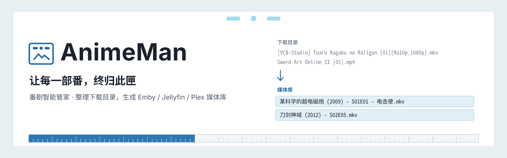
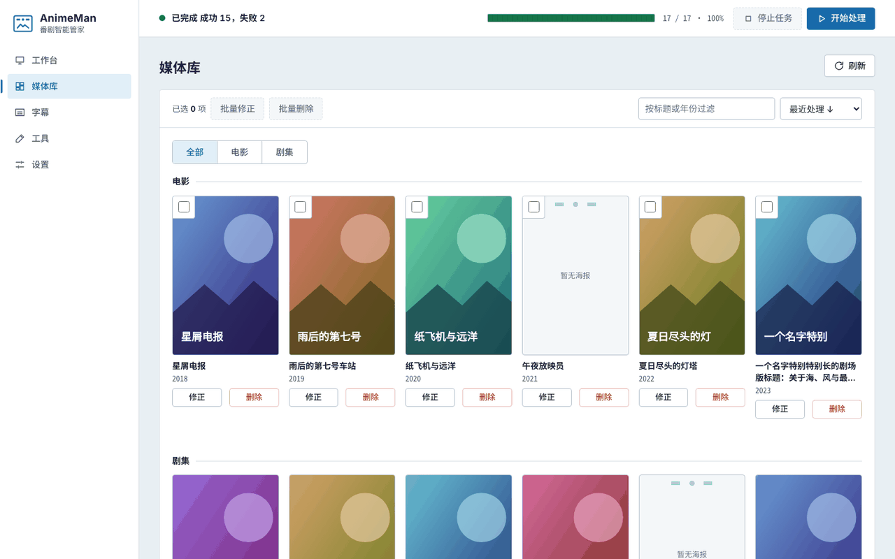
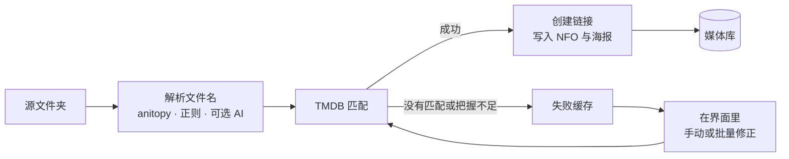
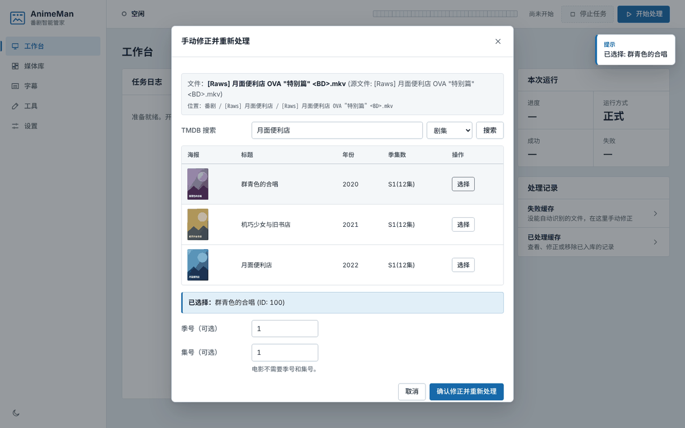
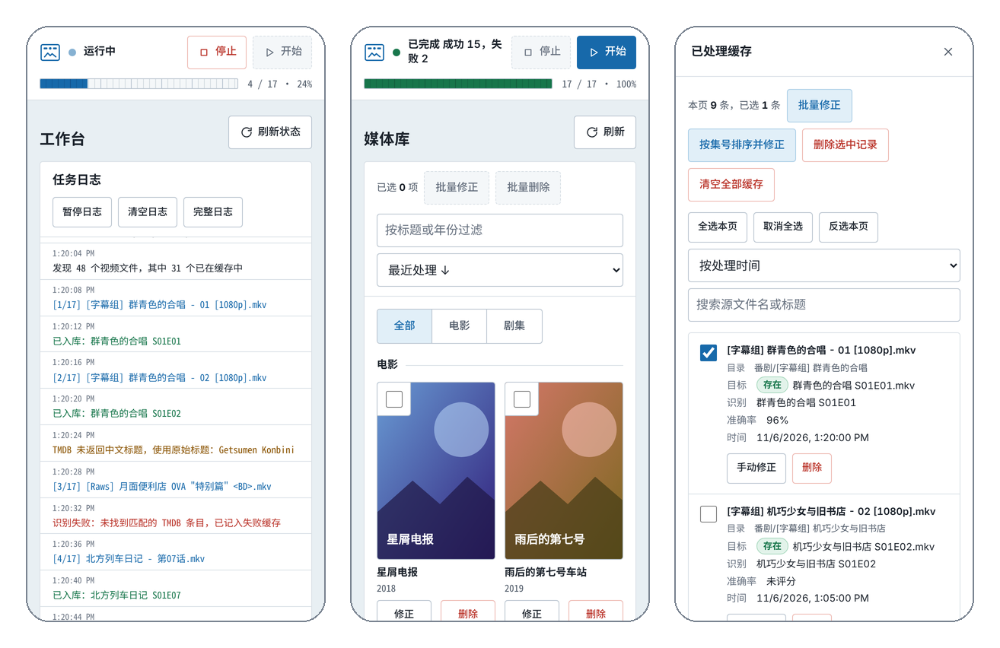

<div align="center">

<picture>
  <source media="(prefers-color-scheme: dark)" srcset="docs/images/banner-dark.png">
  
</picture>

<br>

**把下载目录里命名混乱的番剧，整理成 Emby / Jellyfin / Plex 能直接识别的媒体库。**<br>
硬链接保种，AI 辅助识别，认不出来的在浏览器里点几下修正。

<br>

[](https://github.com/gegd19/AnimeMan/releases)
[](https://github.com/gegd19/AnimeMan/actions/workflows/ci.yml)
[](https://www.python.org/)
[](https://flask.palletsprojects.com/)
[](DEPLOYMENT.md)

[快速开始](#快速开始) · [功能](#功能) · [界面](#界面) · [配置](#配置) · [常见问题](#常见问题) · [文档](#文档)

</div>

<br>

<picture>
  <source media="(prefers-color-scheme: dark)" srcset="docs/images/library-dark.png">
  
</picture>

## 它做什么

下载目录里是这样的：

```text
/downloads/anime/[VCB-Studio] Toaru Kagaku no Railgun [Ma10p_1080p]/
├── [VCB-Studio] Toaru Kagaku no Railgun [01][Ma10p_1080p][x265_flac].mkv
├── [VCB-Studio] Toaru Kagaku no Railgun [02][Ma10p_1080p][x265_flac].mkv
├── [VCB-Studio] Toaru Kagaku no Railgun S [01][Ma10p_1080p][x265_flac].mkv
├── [VCB-Studio] Toaru Kagaku no Railgun [OVA][Ma10p_1080p][x265_flac].mkv
└── [VCB-Studio] Toaru Kagaku no Railgun [NCED][Ma10p_1080p][x265_flac].mkv
```

点一下「开始处理」，媒体库里是这样的：

```text
/media/TV Shows/某科学的超电磁炮 (2009)/
├── tvshow.nfo
├── poster.jpg
├── fanart.jpg
├── Season 01/
│   ├── 某科学的超电磁炮 (2009) - S01E01 - 电击使.mkv     ← 硬链接，不占额外空间
│   ├── 某科学的超电磁炮 (2009) - S01E01 - 电击使.nfo
│   └── …
├── Season 02/
│   └── …
└── Season 00/                                             ← OVA 按映射规则归入特别篇
    └── …
```

源视频不移动、不改名，继续做种；媒体服务器拿到的是标准目录、NFO 和海报。上面是示意：片名、年份和集标题来自 TMDB，OVA 的归类取决于你添加的映射规则，`NCED` 这类文件由忽略关键词跳过。



## 功能

| 功能 | 说明 |
| --- | --- |
| **看得懂番剧命名** | 内置 [anitopy](https://github.com/igorcmoura/anitopy) 解析压制组文件名，处理 `[01]` 方括号集号、`II` / `III` 罗马数字季号和总集数换算。 |
| **AI 兜底** | 规则解析不了时交给大模型，支持 DeepSeek、OpenAI、智谱、通义千问。同一文件夹批量解析一次并缓存；不填 Key 就只用规则解析。 |
| **硬链接保种** | 默认创建硬链接，不复制、不移动源视频。跨盘无法硬链接时自动改用符号链接，并在日志里提示。 |
| **刮削一次到位** | 生成 `movie.nfo` / `tvshow.nfo` / `season.nfo` 和每集 NFO，下载 TMDB 海报与背景图。`--repair` 可以为已有媒体库补齐缺失的元数据。 |
| **失败的不会被悄悄跳过** | 识别失败的文件集中在失败缓存里，按文件夹聚合。可以逐个修正，也可以整个文件夹批量修正：在弹窗里搜索 TMDB、调整顺序、设置起始集号，总集数可自动跨季换算。 |
| **特典与 OVA** | 用关键词映射规则把特定文件直接指到某个 TMDB 条目的季和集，优先级最高。 |
| **字幕中心** | 扫描字幕文件夹，按标题相似度自动匹配到媒体库里的条目；也可以强制按集号匹配或交给 AI 分组。可选用 ffsubsync 自动调轴。 |
| **媒体库管理** | 在网页里浏览已入库的电影和剧集，展开季集，重新修正或移除。删除只移除媒体库里的链接，不碰源文件。 |
| **先看计划再动手** | 模拟运行只生成处理计划，不创建链接、不写缓存。 |
| **手机也能用** | 五个页面，桌面是侧栏，手机是底部标签栏；浅色与深色主题；弹窗和表格在小屏上重新排版。 |

### 适合谁，不做什么

适合：PT / BT 下载需要保种，同时想要一个整洁媒体库的人；手里有大量命名各异的 BDRip、特典和 OVA 的收藏者；习惯在手机或平板上管理 NAS 的人。

不做：AnimeMan 只整理**已经下载好**的文件。它不负责搜索、下载和订阅追番，也不转码。

## 界面

<table>
  <tr>
    <td width="50%"></td>
    <td width="50%"></td>
  </tr>
  <tr>
    <td align="center"><sub>工作台 · 顶部任务条在所有页面常驻</sub></td>
    <td align="center"><sub>手动修正 · 搜索 TMDB 后重新入库</sub></td>
  </tr>
</table>

<div align="center">
  
  <br>
  <sub>手机 · 工作台、媒体库、已处理缓存</sub>
</div>

<br>

<sub>截图由 <code>node tests/ui_preview.cjs</code> 用合成数据生成，片名和海报都是虚构的。</sub>

## 快速开始

需要先准备一个免费的 [TMDB API Key](https://www.themoviedb.org/settings/api)。

### Docker Compose（推荐）

```bash
git clone https://github.com/gegd19/AnimeMan.git
cd AnimeMan

cp .env.example .env        # 填写 PUID / PGID、三个媒体目录的绝对路径和随机 SECRET_KEY
mkdir -p config cache logs work
```

接着按 [DEPLOYMENT.md](DEPLOYMENT.md#首次准备-compose) 里的脚本生成带管理员密码的最小配置，然后启动：

```bash
docker compose up -d --build
```

打开 `http://127.0.0.1:8000`，在「设置」里填入 TMDB Key，保存后点「测试连接」，回到工作台点「开始处理」。

几件容易踩到的事：

- 默认只监听本机 `127.0.0.1`。要从局域网访问，先确认已启用认证，再修改 `.env` 里的 `BIND_IP`。
- 源目录以只读方式挂载，目标目录需要对 `PUID:PGID` 可写。硬链接要求源和目标在同一个文件系统上。
- Compose 用环境变量指定了三个媒体路径，所以它们在网页里显示为只读。想在网页里改路径，就从 `docker-compose.yml` 里去掉这三项。
- 只运行一个容器实例，不要开多个副本或 worker。
- 从旧版本升级前先备份，旧容器里的数据不会自动迁移，见 [T04-NOTES.md](T04-NOTES.md)。

<details>
<summary><b>源码运行</b></summary>

<br>

需要 Python 3.12。

```bash
git clone https://github.com/gegd19/AnimeMan.git
cd AnimeMan

python3.12 -m venv .venv
. .venv/bin/activate                  # Windows PowerShell: .\.venv\Scripts\Activate.ps1
python -m pip install --require-hashes -r requirements.lock

cp auto_config.json.example auto_config.json    # 填写 TMDB Key 和路径
python web_app.py
```

访问 `http://127.0.0.1:8000`。入口使用单进程 Waitress，监听地址、线程数和停机行为见 [DEPLOYMENT.md](DEPLOYMENT.md)。

</details>

<details>
<summary><b>命令行</b></summary>

<br>

```bash
# 只生成整理计划，不写媒体、配置或缓存
python main.py --config /绝对路径/auto_config.json --dry-run

# 忽略增量缓存，重新处理扫描到的全部文件
python main.py --config /绝对路径/auto_config.json --force-full

# 为已有媒体库补齐缺失的 NFO 和图片（建议先加 --dry-run 看计划）
python main.py --config /绝对路径/auto_config.json --repair

# 测试能否连上 TMDB
python main.py --config /绝对路径/auto_config.json --test-tmdb
```

命令行参数只影响本次运行，不改写配置文件。模拟运行仍然可能调用 TMDB 和 AI 接口，所以不等于离线运行。完整说明见 [T05-NOTES.md](T05-NOTES.md)。

</details>

## 配置

常用配置可以在网页的「设置」里修改，也可以直接编辑 `auto_config.json`（示例见 [auto_config.json.example](auto_config.json.example)）。

| 配置项 | 必填 | 说明 |
| --- | :---: | --- |
| `tmdb_api.api_key` | 是 | TMDB API Key |
| `source_folders` | 是 | 下载目录，可以有多个 |
| `tv_target_folder` | 是 | 媒体服务器的剧集库目录 |
| `movie_target_folder` | 是 | 媒体服务器的电影库目录 |
| `link_type` | | `hard`（默认，同盘）或 `symlink`（跨盘） |
| `ai_parser.enabled` / `api_key` | | 开启 AI 解析。调用大模型可能产生费用 |
| `ai_parser.provider` | | `deepseek`、`openai`、`zhipu`、`qwen` |
| `ignore_patterns` | | 文件名包含这些关键词时跳过，例如 `NCED`、`sample` |
| `dry_run` | | 模拟运行，只生成计划 |
| `incremental` | | 增量处理，跳过已处理的文件（默认开启） |
| `tmdb_api.proxy` | | 访问 TMDB 的代理，例如 `http://127.0.0.1:7890` |
| `auth.enabled` | | HTTP 基本认证。对外开放前务必开启 |

密钥和密码保存在服务端，页面不会回显：输入框留空表示保留原值，清除需要勾选对应的复选框。

## 运行须知

| 主题 | 要点 | 详细说明 |
| --- | --- | --- |
| 任务 | 同一时间只运行一个写任务，其他写操作会收到 HTTP 409。点击停止后要等工作线程退出才能开始新任务。 | [T06](T06-NOTES.md) |
| 缓存与重试 | 缓存原子写入。文件损坏时保留原件、创建备份并报错，不会自动清空。临时网络失败会在之后的任务里退避重试。 | [T07](T07-NOTES.md) |
| 元数据 | NFO 和图片经过校验后原子写入；修复时替换无效旧文件前先备份。 | [T08](T08-NOTES.md) |
| 特典与集号 | 可以通过 `scan_policy.include_specials` 扫描特典目录。无法确定的集号保持未知，不会被当成第 1 集。 | [T09](T09-NOTES.md) |
| AI 解析 | AI 返回的季集号经过校验；结果随文件和解析配置变化而失效。 | [T10](T10-NOTES.md) |
| 字幕 | 调轴在临时目录里处理副本，源字幕保持不变。 | [T11](T11-NOTES.md) |
| 输入校验 | 接口严格校验类型和范围；配置文件损坏时拒绝提供业务访问并保留原件，而不是回退成关闭认证的默认配置。 | [T13](T13-NOTES.md) |
| 媒体身份 | 电影和剧集即使 TMDB ID 相同也分开处理，海报地址带类型，如 `/media_poster/tv/7`。 | [T14](T14-NOTES.md) |
| 部署 | 单进程、非 root 容器、依赖带散列锁定；停机时等待写线程安全退出。 | [DEPLOYMENT.md](DEPLOYMENT.md) |

## 常见问题

**下载盘和媒体库不在同一块硬盘，还能用吗？**<br>
能。硬链接只在同一个文件系统内有效，跨盘时会自动尝试符号链接并在日志里提示。用符号链接时，源路径也必须对媒体服务器可见。想用硬链接，就把下载目录和媒体库放在同一个分区。

**不想用 AI 可以吗？**<br>
可以。不填 AI Key 时只用 anitopy 和正则解析，识别不了的文件进入失败缓存，由你手动修正。

**AI 解析贵吗？**<br>
取决于你选的模型和文件数量。「文件夹批量解析」让同一个文件夹只调用一次，结果会缓存；也可以在「工具」页提前做离线预解析。

**特典被识别成了正片的某一集怎么办？**<br>
在「工具 → 特辑 / OVA 映射规则」里添加关键词，指定 TMDB ID 和季、集号。这条规则的优先级高于自动识别。

**删除媒体库里的条目会删掉源文件吗？**<br>
不会。网页里的删除只移除媒体库中的目标文件（链接）和对应记录。

**支持 Windows 吗？**<br>
可以用源码方式运行，Windows 上创建符号链接可能需要开启「开发者模式」。CI 里有 Windows 的链接与长路径检查，但还没有在真实 Windows 机器上完整验证过。

## 开发与测试

技术栈：Python 3.12 · Flask · Waitress · anitopy · TMDB API v3 · ffsubsync / pysubs2 · 原生 JavaScript 与 CSS（没有前端构建步骤）。

```bash
python -m pip install --require-hashes -r requirements-dev.lock
npm ci --ignore-scripts && npx playwright install chromium

python -m pytest -q --tb=short                    # 后端回归
ANIMEMAN_TEST_PYTHON=python npm run test:ui       # 界面测试：真实模板 + 真实 Chromium，请求全部 mock
node tests/ui_preview.cjs /tmp/animeman-preview   # 用合成数据生成各页面截图
```

测试只使用临时目录里的合成文件和虚拟凭据，不访问真实媒体、TMDB 或 AI 接口。详见 [TESTING.md](TESTING.md)。

## 文档

| 文档 | 内容 |
| --- | --- |
| [DEPLOYMENT.md](DEPLOYMENT.md) | 部署、目录权限、停机与回滚 |
| [TESTING.md](TESTING.md) | 测试方式与覆盖范围 |
| [RELEASE_NOTES.md](RELEASE_NOTES.md) · [CHANGELOG.md](CHANGELOG.md) | v1.0.0 的变化与升级要求 |
| [UI-REFRESH-NOTES.md](UI-REFRESH-NOTES.md) | 界面设计说明 |
| `T01-NOTES.md` – `T15-NOTES.md` | 各项维护工作的范围、验证和回滚记录 |

## 贡献与许可证

欢迎提交 Issue 和 PR。遇到识别不了的文件名，请把文件名样本（不需要文件本身）附在 Issue 里。

本项目以 MIT 许可证发布。

<br>

<div align="center">
  <sub>AnimeMan · 让每一部番，终归此匣</sub>
</div>
