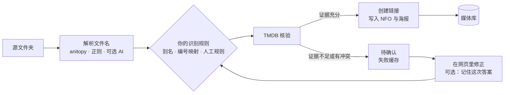
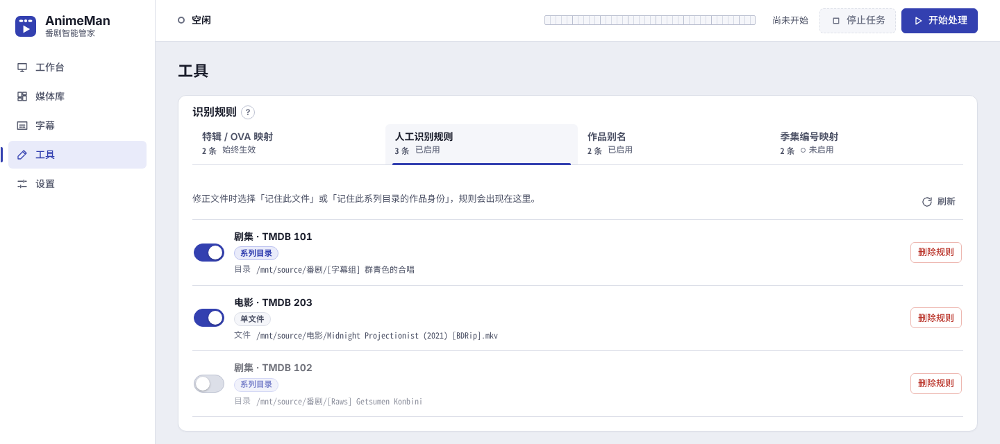
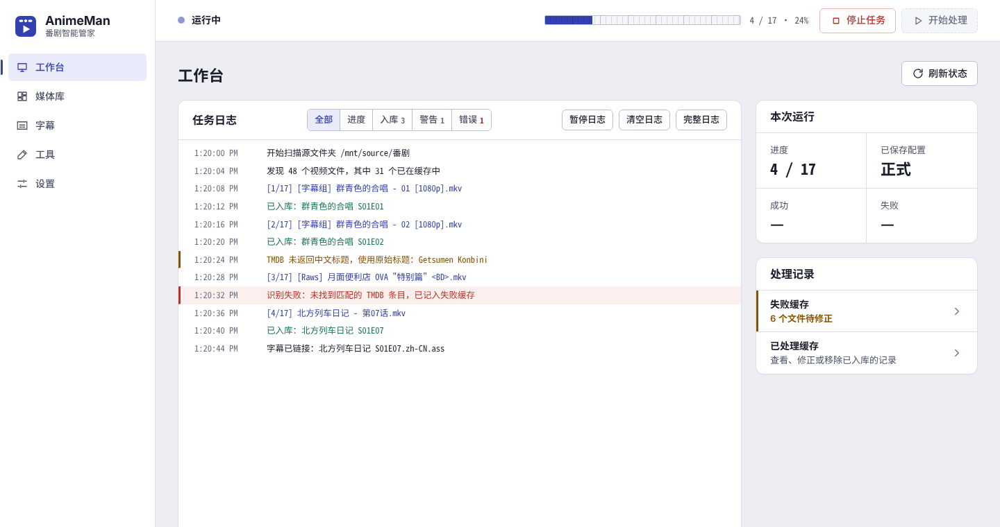
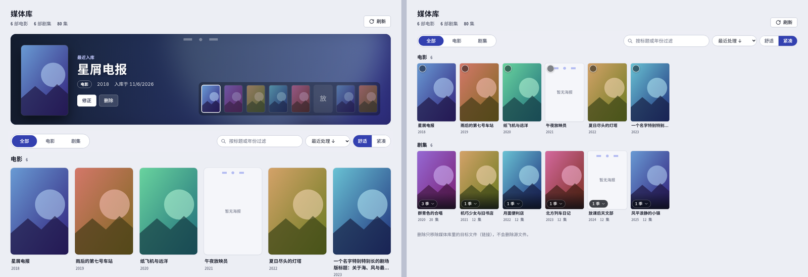

<div align="center">

<picture>
  <source media="(prefers-color-scheme: dark)" srcset="docs/images/banner-dark.png">
  
</picture>

<br>

**把下载目录里命名混乱的番剧，整理成 Emby / Jellyfin / Plex 直接认得的媒体库。**<br>
源文件原地做种，媒体库用硬链接。认不准的不硬猜，交给你一键确认。

<br>

[](https://github.com/gegd19/AnimeMan/releases)
[](https://github.com/gegd19/AnimeMan/actions/workflows/ci.yml)
[](https://www.python.org/)
[](DEPLOYMENT.md)
[](#开发与测试)

[快速开始](#快速开始) · [识别规则](#认不准的不硬猜) · [界面](#界面) · [配置](#配置) · [常见问题](#常见问题)

</div>

<br>

<picture>
  <source media="(prefers-color-scheme: dark)" srcset="docs/images/library-dark.png">
  
</picture>

## 下载目录进去，媒体库出来

你的下载目录：

```text
/downloads/anime/[VCB-Studio] Toaru Kagaku no Railgun [Ma10p_1080p]/
├── [VCB-Studio] Toaru Kagaku no Railgun [01][Ma10p_1080p][x265_flac].mkv
├── [VCB-Studio] Toaru Kagaku no Railgun [02][Ma10p_1080p][x265_flac].mkv
├── [VCB-Studio] Toaru Kagaku no Railgun S [01][Ma10p_1080p][x265_flac].mkv
├── [VCB-Studio] Toaru Kagaku no Railgun [OVA][Ma10p_1080p][x265_flac].mkv
└── [VCB-Studio] Toaru Kagaku no Railgun [NCED][Ma10p_1080p][x265_flac].mkv
```

点一下「开始处理」，媒体服务器看到的是：

```text
/media/TV Shows/某科学的超电磁炮 (2009)/
├── tvshow.nfo · poster.jpg · fanart.jpg
├── Season 01/
│   ├── 某科学的超电磁炮 (2009) - S01E01 - 电击使.mkv     ← 硬链接，不占额外空间
│   └── 某科学的超电磁炮 (2009) - S01E01 - 电击使.nfo
├── Season 02/ …
└── Season 00/ …                                          ← OVA 按你的映射归入特别篇
```

源视频不移动、不改名，继续做种。片名、年份和集标题来自 TMDB，`NCED` 这类文件由忽略关键词跳过。上面是示意，OVA 的去向取决于你添加的规则。



## 认不准的不硬猜

番剧命名的难点不在常见格式，而在罗马音标题、总集数、`12.5` 这样的小数集、名字几乎一样的续作。v1.2.0 的原则是：**没有可靠证据就停下来等你确认，而不是挑一个最像的。**

在一组 49 个离线难例上（TMDB 和 AI 都是 mock），旧策略自动通过了 32 个，其中 13 个是错的；现在自动通过 18 个，**错误自动通过为 0**，其余 31 个进入待确认（[评估报告](reports/recognition-r10-report.md) · [验收口径](reports/recognition-r10-approved-acceptance.md)）。这是 mock 样本的结果，不代表真实识别率，但它说明了取舍：你多点几次确认，换来媒体库里没有悄悄放错的番。

确认过的答案可以留下来，下次不用再教。四类规则集中在「工具 → 识别规则」：



| 规则 | 什么时候用 | 例子 |
| --- | --- | --- |
| **特辑 / OVA 映射** | 文件名里有固定关键词，要直接指到某一季某一集。优先级最高，始终生效 | `[OVA]` → 第 0 季第 1 集 |
| **人工识别规则** | 修正文件时勾选「记住此文件」或「记住此系列目录」，同目录的后续文件直接用这个作品身份 | 整个 `[Raws] Getsumen Konbini/` 目录就是 TMDB 102 |
| **作品别名** | 文件名用的是日文罗马音或外文原名。先预览，核验 TMDB 身份后才能保存；不同作品撞名时交给你确认 | `Gunjou no Gasshou` → 群青色的合唱 |
| **季集编号映射** | 文件里的编号和 TMDB 季集对不上：总集数、小数集、前导零 | 13–24 → 第 2 季第 1 集起；`12.5` → 第 0 季第 1 集 |

除特辑映射外，三类规则**默认关闭**，在「设置 → 识别与 AI」里启用。所有规则只在你指定的源目录范围内生效，不会影响别的文件夹。

评分也说实话：自动匹配显示「匹配评分」，人工确认或规则指定的显示「人工指定」，没有评分的显示「未评分」。不会把人工指定显示成 100%，也不会把缺失显示成 0%。

## 功能

| 功能 | 说明 |
| --- | --- |
| **看得懂番剧命名** | 内置 [anitopy](https://github.com/igorcmoura/anitopy)，处理压制组标签、`[01]` 方括号集号、`II` / `III` 罗马数字季号和总集数跨季换算。罗马数字到底是季号还是标题的一部分说不准时，交给你确认。 |
| **AI 兜底，可选** | 规则解析不了时交给 DeepSeek、OpenAI、智谱或通义千问。同一文件夹只调用一次并缓存，返回的季集号会校验。不填 Key 就只用规则解析。 |
| **硬链接保种** | 默认硬链接，不复制、不移动源视频；跨盘时改用符号链接并在日志里提示。 |
| **刮削一次到位** | 生成电影、剧集、季和每集的 NFO，下载海报与背景图。`--repair` 为已有媒体库补齐缺失的元数据。 |
| **失败的不会被悄悄跳过** | 识别失败的文件按文件夹聚合在失败缓存里，逐个或整个文件夹批量修正：搜索 TMDB、调整顺序、设置起始集号。工作台直接显示还有几个文件待修正。 |
| **字幕中心** | 扫描字幕文件夹，按标题相似度匹配到媒体库；也可以强制按集号匹配或交给 AI 分组。可选 ffsubsync 调轴，处理的是副本。 |
| **媒体库管理** | 海报墙浏览电影和剧集，就地展开季集，勾选后批量修正或删除。删除只移除媒体库里的链接，不碰源文件。 |
| **先看计划再动手** | 模拟运行只生成处理计划，不创建链接、不写缓存，界面上也不会把它显示成已完成。 |
| **大海报，或者一屏看完** | 「舒适」用大海报浏览；整理大量条目时切到「紧凑」，海报变小、行距收紧、说明收起。只记在浏览器里。 |
| **手机也能用** | 桌面是侧栏，手机是底部标签栏；浅色、深色和跟随系统三种主题。 |

**不做什么**：AnimeMan 只整理已经下载好的文件，不负责搜索、下载、订阅追番，也不转码。

## 界面

<table>
  <tr>
    <td width="50%"></td>
    <td width="50%"></td>
  </tr>
  <tr>
    <td align="center"><sub>工作台 · 运行时日志优先，顶部任务条在所有页面常驻</sub></td>
    <td align="center"><sub>手动修正 · 选对之后可以记住，下次自动识别</sub></td>
  </tr>
</table>



<div align="center"><sub>舒适 / 紧凑 · 同一个媒体库</sub></div>

<br>

<div align="center">
  
  <br>
  <sub>手机 · 工作台、媒体库（舒适）、媒体库（紧凑）</sub>
</div>

<br>

<sub>截图由 <code>node tests/ui_preview.cjs</code> 用合成数据生成，片名、海报、路径和规则都是虚构的。</sub>

## 快速开始

先准备一个免费的 [TMDB API Key](https://www.themoviedb.org/settings/api)。

### Docker Compose（推荐）

```bash
git clone https://github.com/gegd19/AnimeMan.git
cd AnimeMan

cp .env.example .env        # 填写 PUID / PGID、三个媒体目录的绝对路径和随机 SECRET_KEY
mkdir -p config cache logs work
```

按 [DEPLOYMENT.md](DEPLOYMENT.md#首次准备-compose) 里的脚本生成带管理员密码的最小配置，然后启动：

```bash
docker compose up -d --build
```

打开 `http://127.0.0.1:8000`，在「设置」里填 TMDB Key，保存后点「测试连接」，回到工作台点「开始处理」。第一次建议先勾「模拟运行」看看计划。

容易踩到的几件事：

- 默认只监听本机 `127.0.0.1`。要从局域网访问，先启用认证，再改 `.env` 里的 `BIND_IP`。
- 源目录只读挂载，目标目录要对 `PUID:PGID` 可写。硬链接要求源和目标在同一个文件系统。
- Compose 用环境变量指定了三个媒体路径，所以它们在网页里是只读的。想在网页里改，就从 `docker-compose.yml` 里去掉这三项。
- 只运行一个容器实例，不要开多个副本或 worker。
- 从旧版本升级前先备份；旧容器里的数据不会自动迁移，见 [T04-NOTES.md](T04-NOTES.md)。

<details>
<summary><b>源码运行</b></summary>

<br>

需要 Python 3.12。

```bash
git clone https://github.com/gegd19/AnimeMan.git
cd AnimeMan

python3.12 -m venv .venv
. .venv/bin/activate                  # Windows PowerShell: .\.venv\Scripts\Activate.ps1
python -m pip install --require-hashes -r requirements.lock

cp auto_config.json.example auto_config.json    # 填写 TMDB Key 和路径
python web_app.py
```

访问 `http://127.0.0.1:8000`。入口是单进程 Waitress，监听地址、线程数和停机行为见 [DEPLOYMENT.md](DEPLOYMENT.md)。

</details>

<details>
<summary><b>命令行</b></summary>

<br>

```bash
# 只生成整理计划，不写媒体、配置或缓存
python main.py --config /绝对路径/auto_config.json --dry-run

# 忽略增量缓存，重新处理扫描到的全部文件
python main.py --config /绝对路径/auto_config.json --force-full

# 为已有媒体库补齐缺失的 NFO 和图片（建议先加 --dry-run）
python main.py --config /绝对路径/auto_config.json --repair

# 测试能否连上 TMDB
python main.py --config /绝对路径/auto_config.json --test-tmdb
```

命令行参数只影响本次运行，不改写配置文件。模拟运行仍可能调用 TMDB 和 AI，不等于离线运行。完整说明见 [T05-NOTES.md](T05-NOTES.md)。

</details>

## 配置

常用配置都能在网页「设置」里改，也可以直接编辑 `auto_config.json`（示例见 [auto_config.json.example](auto_config.json.example)）。

| 配置项 | 必填 | 说明 |
| --- | :---: | --- |
| `tmdb_api.api_key` | 是 | TMDB API Key |
| `source_folders` | 是 | 下载目录，可以有多个 |
| `tv_target_folder` / `movie_target_folder` | 是 | 媒体服务器的剧集库、电影库目录 |
| `link_type` | | `hard`（默认，同盘）或 `symlink`（跨盘） |
| `ai_parser.enabled` / `provider` / `api_key` | | AI 解析：`deepseek`、`openai`、`zhipu`、`qwen`。调用大模型可能产生费用 |
| `user_rules.enabled` | | 启用人工识别规则，默认关闭 |
| `recognition_aliases.enabled` | | 启用已确认的作品别名，默认关闭 |
| `numbering_maps.enabled` | | 启用季集编号映射，默认关闭 |
| `ignore_patterns` | | 文件名包含这些词时跳过，例如 `NCED`、`sample` |
| `dry_run` | | 模拟运行，只生成计划 |
| `incremental` | | 跳过已处理的文件（默认开启） |
| `tmdb_api.proxy` | | 访问 TMDB 的代理，例如 `http://127.0.0.1:7890` |
| `auth.enabled` | | HTTP 基本认证。对外开放前务必开启 |

密钥和密码保存在服务端，页面不回显：输入框留空表示保留原值，清除要勾选对应的复选框。主题和显示密度只存在浏览器里，不写入配置。

## 运行须知

| 主题 | 要点 | 详细说明 |
| --- | --- | --- |
| 任务 | 同一时间只运行一个写任务，其他写操作收到 HTTP 409。点停止后要等工作线程退出才能开始新任务。 | [T06](T06-NOTES.md) |
| 缓存与重试 | 缓存原子写入；文件损坏时保留原件、创建备份并报错，不会自动清空。临时网络失败会在之后的任务里退避重试。 | [T07](T07-NOTES.md) |
| 元数据 | NFO 和图片经校验后原子写入；修复时替换无效旧文件前先备份。 | [T08](T08-NOTES.md) |
| 特典与集号 | `scan_policy.include_specials` 可扫描特典目录。无法确定的集号保持未知，不会被当成第 1 集。 | [T09](T09-NOTES.md) |
| AI 解析 | AI 返回的季集号经过校验；结果随文件和解析配置变化而失效。 | [T10](T10-NOTES.md) |
| 字幕 | 调轴在临时目录里处理副本，源字幕不变。 | [T11](T11-NOTES.md) |
| 输入校验 | 接口严格校验类型和范围；配置文件损坏时拒绝业务访问并保留原件，不会回退成关闭认证的默认配置。 | [T13](T13-NOTES.md) |
| 媒体身份 | 电影和剧集即使 TMDB ID 相同也分开处理，海报地址带类型，如 `/media_poster/tv/7`。 | [T14](T14-NOTES.md) |
| 识别评估 | 离线难例集、评估口径和逐例结果。全部使用 mock，不代表真实识别率。 | [reports/](reports/recognition-r10-approved-acceptance.md) |
| 部署 | 单进程、非 root 容器、依赖带散列锁定；停机时等写线程安全退出。 | [DEPLOYMENT.md](DEPLOYMENT.md) |

## 常见问题

**为什么有些文件明明只有一个候选，还是要我确认？**<br>
唯一候选不等于正确。没有可核验的证据（TMDB 备用标题、你确认过的别名或规则）时，AnimeMan 宁可停下来。修正时选「记住此系列目录的作品身份」并在设置里启用人工识别规则，同一目录下的文件下次就能直接认出作品（集号仍按文件名解析）。

**文件名是罗马音，TMDB 上只有中文名，怎么办？**<br>
在「工具 → 识别规则 → 作品别名」里添加：填源目录、原文标题和 TMDB ID，先预览核验再保存，并在设置里启用作品别名。

**总集数或 `12.5` 这种集号对不上？**<br>
用「季集编号映射」：单个编号（如 `12.5`、`01`）或一段连续编号（如 13–24）对应到指定的季和起始集。特别篇填第 0 季。多集合并成一个文件的情况仍需手动处理。

**特典被识别成正片的某一集？**<br>
在「工具 → 识别规则 → 特辑 / OVA 映射」里添加关键词，指定 TMDB ID 和季集号。这条规则优先级最高。

**下载盘和媒体库不在同一块硬盘？**<br>
可以用。跨盘时自动改用符号链接并在日志里提示；这时源路径也要对媒体服务器可见。想用硬链接，就把两者放在同一个分区。

**不想用 AI？**<br>
不填 AI Key 即可，只用 anitopy 和正则解析，认不出的进入失败缓存。想省 AI 费用，开启「文件夹批量解析」，或在「工具」里提前做离线预解析。

**删除媒体库里的条目会删掉源文件吗？**<br>
不会。网页里的删除只移除媒体库中的链接和对应记录。

**支持 Windows 吗？**<br>
可以用源码运行，创建符号链接可能需要开启「开发者模式」。CI 里有 Windows 链接与长路径检查，但还没在真实 Windows 机器上完整验证。

## 开发与测试

Python 3.12 · Flask · Waitress · anitopy · TMDB API v3 · ffsubsync / pysubs2 · 原生 JavaScript 与 CSS，没有前端构建步骤，也不依赖 CDN。

```bash
python -m pip install --require-hashes -r requirements-dev.lock
npm ci --ignore-scripts && npx playwright install chromium

python -m pytest -q --tb=short                    # 后端回归
ANIMEMAN_TEST_PYTHON=python npm run test:ui       # 界面测试：真实模板 + 真实 Chromium，请求全部 mock
node tests/ui_preview.cjs /tmp/animeman-preview   # 用合成数据生成各页面截图
python tools/evaluate_recognition.py --help       # 离线识别评估
```

测试只用临时目录里的合成文件和虚拟凭据，不访问真实媒体、TMDB 或 AI。详见 [TESTING.md](TESTING.md)。

## 文档

| 文档 | 内容 |
| --- | --- |
| [DEPLOYMENT.md](DEPLOYMENT.md) | 部署、目录权限、停机与回滚 |
| [TESTING.md](TESTING.md) | 测试方式与覆盖范围 |
| [reports/](reports/) | 识别策略离线评估与验收口径 |
| [RELEASE_NOTES.md](RELEASE_NOTES.md) · [CHANGELOG.md](CHANGELOG.md) | 版本变化与升级要求 |
| [UI-REFRESH-NOTES.md](UI-REFRESH-NOTES.md) | 界面设计说明 |
| `T01-NOTES.md` – `T15-NOTES.md` | 各项维护工作的范围、验证和回滚记录 |

## 贡献与许可证

欢迎提交 Issue 和 PR。遇到认不出的文件名，把文件名样本（不需要文件本身）附在 Issue 里，它可能会成为下一个离线难例。

本项目以 MIT 许可证发布。

<br>

<div align="center">
  <sub>AnimeMan · 让每一部番，终归此匣</sub>
</div>
